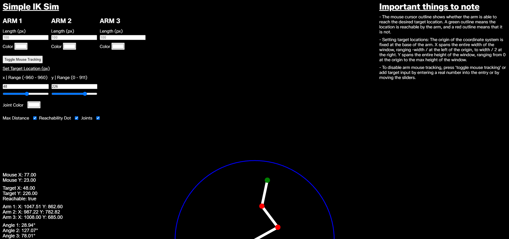

# Simple IK Sim

The purpose of this project is to simulate and visualize a three-link robotic arm with inverse-kinematic
capabilities. 



Features:

- Each member of the arm is customizable, allowing for changes in individual length and appearance.

- Setting target locations for the arm: The origin of the coordinate system is fixed at the base of the arm.
X spans the entire width of the window, ranging -width / 2 at the left of the origin, to width / 2
at the right. Y spans the entire height of the window, ranging from 0 at the origin to the max
height of the window. 

- A mouse cursor outline shows whether the arm is able to reach the desired target location.
A green outline means the location is reachable by the arm, and a red outline means that
it is not.

- Some UI aspects can be disabled such as arm max reach outline, arm joints, and target reachability indicators.

Controls:

-The program allows for toggling between two target modes: mouse tracking, where the arm follows the cursor in
real time, or manual mode, where the exact position can be set.

Built with: html | css | js | p5.js

## Getting Started

Open `index.html` in your web browser to start the program.

## Running Locally

The program can also be run locally using the following methods.

```bash
# Using Python
python -m http.server 8000

# Using Node.js
npx http-server

# Using VS Code Live Server extension
# Right-click index.html -> "Open with Live Server"
```

## Resources

- [p5.js 2.0](https://beta.p5js.org/)
- [p5.js Reference](https://p5js.org/reference/)

## Licensing

This project is licensed under the MIT License — see the [LICENSE](LICENSE) file for details.
